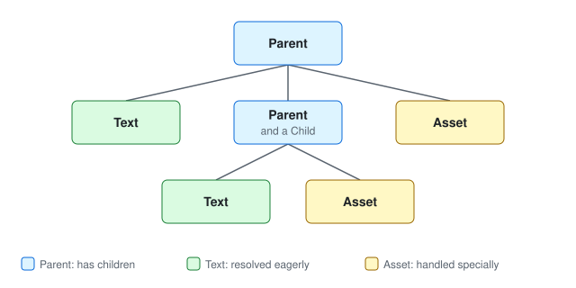
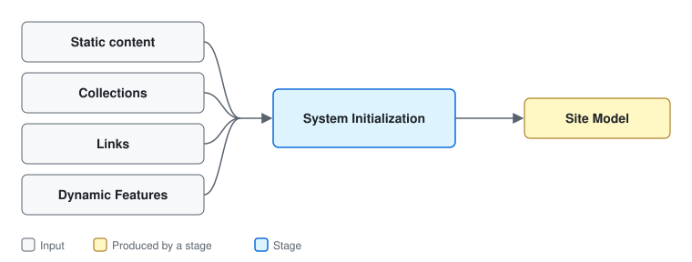
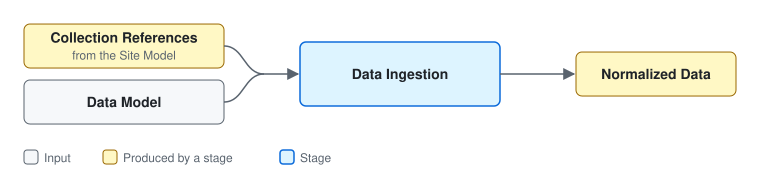
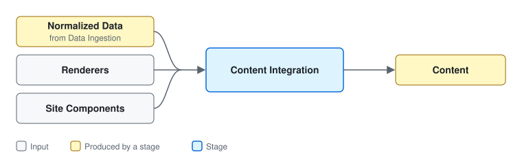
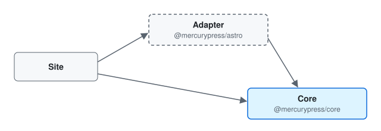

# Mercury

Mercury is a web-based content publishing system. Its goal is to reduce the friction of publishing intellectual property while maintaining sensible website design. This includes automating data loading, simplifying content configuration, and managing site generation for the user.

---

## Architecture & System Design

Mercury prioritizes minimal and secure solutions. The principal concerns are *data modeling* and *presentation* of content.

Mercury is not simply a static site generator. Distinctively, it provides users with tools for streamlining the publishing process for variable content presentation.

---

### Data Model & Content Presentation

Mercury recognizes three *Presentation Types*:

* Single-Document
* Multi-Document
* Enumerable

These Presentation Types depend on a common data model, a *Document Tree*.

#### Document Tree

The **Document Tree** is a *composite tree* structure which allows for modeling complex, hierarchical data, such as is found in file system folders. A Document is a node representing an entry within a collection of data; it can be both a *Parent* and a *Child*:



Supported Document classification includes:

* Parent — A Document that has children
* Text — A Document whose content is text-based
* Asset — A Document whose content is not represented as text

This distribution of taxonomy is derived from data resolution needs. Text Documents are able to resolve content *eagerly* at time of resolution. Asset Documents require special handling of content (such as copying to an asset destination for build use) as opposed to being able to be resolved immediately. Parents must recursively resolve their children.

#### Presentation Types

Presentation Types then serve as context for interpreting the Document Tree.

**Single-Document Presentation** serves a single Document for presentation. It still may use multiple Documents for the sake of building its presentation, as is the case with asset dependencies.

**Multi-Document Presentation** serves a set of Documents. This presentation fundamentally corresponds to the hierarchical organization of the tree.

**Enumerables** are sets of Documents presented in an ordered fashion. This is useful for guides, tutorials, and page-based content.

#### Content Model

A richer *Content Model* is then layered on top of the Document Tree to allow for content-specific publishing concerns, such as the integration of links and rendering.

The Content Model includes:

* Directory (Parent)
* Plain Text (Text)
* Markdown (Text)
* Code (Text)
* Image (Asset)

> The Content Model is open to extension.

---

### Site Generation

Mercury utilizes a site generator (SG) to handle site building. This means Mercury must participate in any runtime environment the SG may provide. Conversely, the SG must adapt its provided functionality to accommodate Mercury's core contracts when necessary.

This could be understood as a *hand-off relationship* between Mercury and the site generator; the nature of this dynamic is primarily determined by the constraints imposed, and functionality provided, by the SG.

> *Astro* is the recommended site generator solution for Mercury.

#### Site Model & Configuration

Mercury's key role in site generation is describing the site's content.

A *Site Model* is provided to the SG. This model is adapted by the SG to allow for Mercury to manage content and hydrate components.

The Site Model describes:

* Static content (copy, logos, etc.)
* Collections (dynamically loaded data)
* Links
* Features (dynamic functionality)

The Site Model can be configured by the user, allowing for customization without directly interacting with Mercury source code.

#### Components

Components refers to any reusable HTML templates an SG may provide. A paramount task in resolving the relationship between Mercury and the SG is adapting the SG's Components to accept Mercury's content input.

#### Publishing

Mercury provides publishing solutions for content. A publishing solution is a content-specific strategy for presenting itself in HTML. These strategies are defined via the Content Model and accept dependency injection (e.g., components, renderers, etc.).

```
Content:
  publish(dependencies) -> renderableContentPackage
```

> "Publish" is a Mercury-specific term to describe the process of content integration. This should not be confused with its conventional meaning.

> `renderableContentPackage` represents the SG-specific implementation used to render content on the site. For example, as with Astro, this may include a Component and its props (see example below).

This is not to be mistaken for build-time components — Mercury requires its SG runtime to supply a medium for integrating published content into the site. For instance, an *Astro* solution may look like:

```astro
---
import ComponentFactory from 'ComponentFactory';

const { content } = Astro.props;
const { Component, props } = content.publish({
  ComponentFactory
});
---

<Component {...props} />
```

where `content` can refer to an instance of any Content Model type:

* Directory
* Plain Text
* Markdown
* Code
* Image

`Component` then refers to the Astro-specific reusable component that is injected into Mercury. For instance, a Markdown component may look like:

```astro
---
const { rendered } = Astro.props;
const html = rendered.html;
---

<div class="markdown" set:html={html} />
```

#### Routing

Mercury defines URL path resolution for its Content. In general, Content is scoped to its entry and collection.

```
website-root/[collection]/[entry]/[content]
```

Since Content can have children itself, Content may be scoped to parent Content.

```
website-root/[collection]/[entry]/[parent content]/[child content]
```

Mercury must interface with the SG to produce these routes according to the uploaded data.

---

### Pipeline Architecture

A Mercury site may be understood as progressing through a series of stages:

1. System Initialization
2. Data Ingestion
3. Content Integration
4. Build

These stages describe the process by which data converges into a concrete site.

**System Initialization** produces the Site Model.



**Data Ingestion** uses the Site Model to source and resolve data into *Normalized Data* (Presentation Types and Document Tree).



**Content Integration** consolidates existing resources to form renderable Content.



**Build** integrates the Content and Site Model into buildable components, finally building and producing the final *Site*.


> Build is principally a responsibility of the chosen SG. This model demonstrates the abstract processing a Mercury site passes through, not necessarily a Mercury-owned runtime nor its responsibility boundaries.

This pipeline intermittently interacts with its chosen SG via *hand-offs*.

> Mercury does not own pipeline execution. Integration of Mercury into the build runtime requires orchestration of the pipeline.

### Mercury Core

While the dynamic between Mercury and the SG is dependent on the specific features and constraints posed by the SG, certain responsibilities remain in Mercury's domain:

* Data Model & Presentation Types
* Site Model
* Content Presentation

Boundaries are established according to a set of principles:

1. **Mercury's domain doesn't depend on any SG-specific implementation.** It can be run, and reasoned about, without a site generator present.
2. **Where the domain needs SG-specific implementation, it defines contracts.** This is where *hand-offs* back to Mercury take place.
3. **An adapter fulfills these contracts for its chosen SG.** An Astro adapter must define the Astro-specific implementation according to Mercury contracts.
4. **Dependencies point toward the domain.** A site depends on its adapter, an adapter depends on the domain, and the domain depends on neither.

#### Packages

These principles divide Mercury into a domain, which is independent of any SG, and the adapters that fulfill its contracts. Mercury's packages follow from this division:

* `@mercurypress/core` — Mercury's domain and the contracts it defines. It contains no SG-specific implementation (principle 1).
* `@mercurypress/astro` — An adapter for Astro, the recommended SG. It fulfills core's contracts with Astro's components, renderers, and runtime (principle 3).

A *site* then supplies its own configuration and content. Since Mercury does not own pipeline execution, the site is also where the pipeline is orchestrated, through its adapter.



> Supporting another SG requires only another adapter; core remains unchanged.
